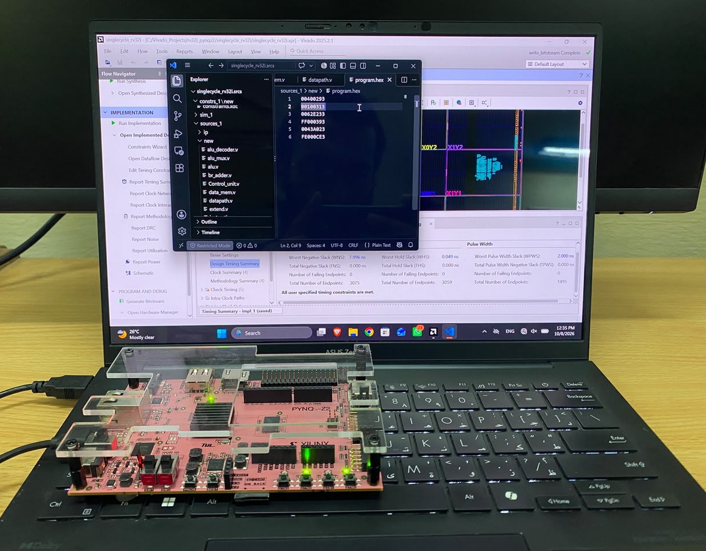
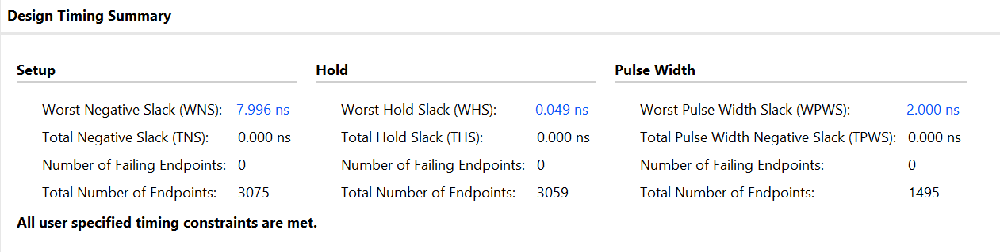
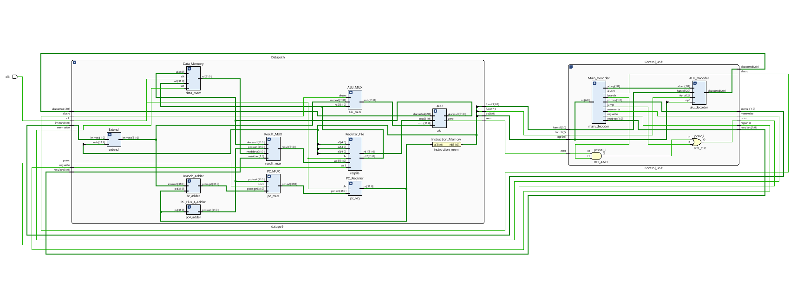

# Single-Cycle RV32I Processor on PYNQ-Z2

My first full CPU: a 32-bit single-cycle RISC-V core (an RV32I subset) written
in Verilog, tested module by module in simulation, then put on a real PYNQ-Z2
board where it runs a program and blinks LEDs. The design follows the
single-cycle processor in Harris & Harris, *Digital Design and Computer
Architecture: RISC-V Edition* (Ch. 7).

## What it does
- Runs 10 instructions: ADD, SUB, AND, OR, SLT, ADDI, LW, SW, BEQ, JAL
- 16 modules, and every one has its own self-checking testbench, plus a
  full-program test where the whole CPU runs real instructions
- Runs at 50 MHz on the board (an MMCM turns the 125 MHz board clock into 50 MHz)
- Timing is met: WNS 7.996 ns, WHS 0.049 ns, 0 failing endpoints
- No inferred latches (checked, not assumed)
- Works on real hardware: the program drives the on-board LEDs, and I watch the
  PC live over JTAG with a VIO core

## How it's put together
Standard split: a datapath plus a control unit (main decoder, ALU decoder, and
a small gate that decides whether to take a branch or jump).

| Block | What it does |
|---|---|
| Register file | 2 async read ports, 1 sync write port, x0 is hardwired to 0 |
| ALU | add, sub, and, or, slt (signed), plus a zero flag for branches |
| Extend | builds the I/S/B/J immediates (ImmSrc is 2 bits) |
| Instruction memory | word-indexed, filled from `program.hex` with `$readmemh` |
| Data memory | word-indexed, synchronous write |
| Control | main decoder -> ALUOp -> ALU decoder; PCSrc = (Branch & Zero) \| Jump |
| PC register | synchronous reset to 0x00001000 |

ALUControl encoding: 000 add, 001 sub, 010 and, 011 or, 101 slt.

## Talking to the LEDs
There's one memory-mapped output: a store to `0xFFFFFFF0` writes `wdata[3:0]`
to the 4 on-board LEDs. Reset is wired to a push button (BTN0), so I can restart
the program without reprogramming the board.

## The demo program (`program/program.hex`)
| Addr | Hex | Instruction | What happens |
|---|---|---|---|
| 0x1000 | 00400293 | addi x5, x0, 4 | x5 = 4 |
| 0x1004 | 00100313 | addi x6, x0, 1 | x6 = 1 |
| 0x1008 | 0062E233 | or x4, x5, x6 | x4 = 5 |
| 0x100C | FF000393 | addi x7, x0, -16 | x7 = 0xFFFFFFF0 (the LED address) |
| 0x1010 | 0043A023 | sw x4, 0(x7) | LEDs show 0101 |
| 0x1014 | FE000CE3 | beq x0, x0, -8 | jump back to 0x100C |

On the board, that means LD0 and LD2 are lit and LD1 and LD3 are off 
(`0101`, with LD0 as the rightmost bit).

After the first few instructions, the PC just loops through 0x100C, 0x1010 and
0x1014, which is exactly what the VIO shows on the board.

## Running the simulations
1. Make a Vivado project for part xc7z020clg400-1.
2. Add `rtl/` as design sources, `tb/` as simulation sources, and
   `program/program.hex` as a source too (otherwise `$readmemh` can't find it).
3. Set any `*_tb` module as top and run Behavioral Simulation. Every testbench
   prints PASS or FAIL in the Tcl console.

## Building it for the board
1. Add `fpga/rv32i_fpga_top.v`, `fpga/constraints.xdc`, and the IP in `fpga/ip/`
   (Clocking Wizard `clk_wiz_0`: 125 MHz in, 50 MHz out. VIO `vio_0`: two
   32-bit probe inputs).
2. Set `rv32i_fpga_top` as top, then run synthesis, implementation, and
   generate the bitstream.
3. Program the board and open the VIO in Hardware Manager.

## How I tested it
For each module I wrote down what the spec actually claims (does the basic case
work, what about boundary values, are control signals tested in both states,
do parallel parts interfere with each other) and wrote one test per claim.
Integration tests only check the wiring between modules that were already
verified, so I'm not re-testing the same logic over and over.

I built it bottom-up: leaf modules first, then the control unit, then the
datapath, then the full processor running a real program.

## Things that bit me
- **Simulation vs. hardware register initialization.** My testbenches preloaded
  registers directly, but on the board they power up as 0. The first program
  ORed two zero registers and stored `0x00000000` to the LED address, so the
  LEDs stayed dark even though the PC was clearly moving on the VIO. I fixed it
  by rewriting `program.hex` so the program initializes its own registers with
  `addi`.
- **Checking `zero` after the clock edge gave me X.** My `beq` test failed even
  though the PC branched correctly. The branch had already moved the PC by the
  time I looked, so the combinational logic was evaluating the *next*
  instruction with the old control signals. The fix was to sample `zero` just
  before the edge, while it still belonged to the branch.

## Known limitations
- Single-cycle, so the clock period is set by the slowest instruction (LW).
- No `lui` or `auipc`, so you can't build big constants in one instruction.
- Data memory isn't gated against the MMIO address range, so the LED store also
  writes an aliased location in data memory. The demo program never reads it
  back, so nothing visible breaks.
- Memory sizes are small and fixed.

## Reference
Harris & Harris, *Digital Design and Computer Architecture: RISC-V Edition*
(Elsevier, 2022).
